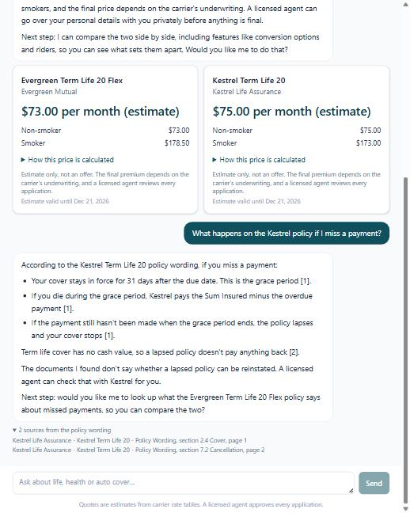
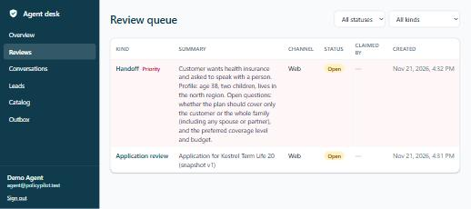
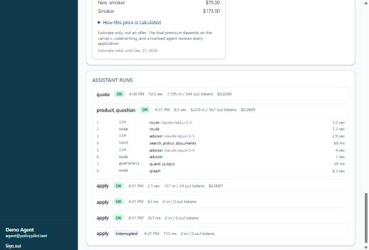
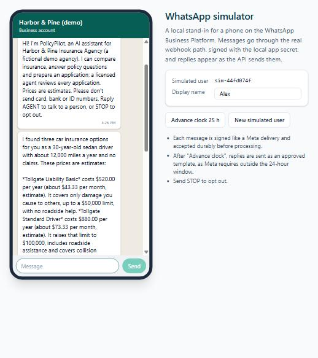
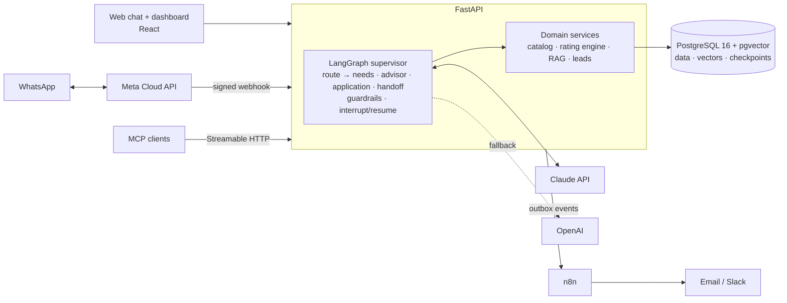

# PolicyPilot

**An AI copilot for a multi-carrier insurance agency.** It helps customers on web chat and
WhatsApp find, compare and apply for cover, while licensed human agents stay in control of
anything binding.

> **Status: Phase 1 built and running locally; not deployed.** Everything in the table below
> exists and is tested in CI with a scripted demo model, and the eval suite has been run against
> Claude through the live API ([results](docs/evals/latest.md)). The OpenAI fallback has not been
> run against its live API (see [Known limitations](#known-limitations)). All carriers,
> products, rates, documents and people in this repository are **fictional**.

## Screenshots

Taken on a freshly seeded local stack with Claude answering through the live API
(`claude-opus-5-5` and `claude-haiku-5-5`), not the scripted demo model. All data shown is
fictional.

| Chat: quotes from the rating engine and a cited answer | Agent desk: review queue |
|---|---|
|  |  |
| **Agent desk: run traces of a conversation** | **WhatsApp simulator** |
|  |  |

## Feature status

| Feature | Status | Notes |
|---|---|---|
| Deterministic rating engine | **Built** | Versioned rate tables, Decimal arithmetic, factor breakdowns, eligibility rules. Covered by golden and property tests. |
| Fictional catalog | **Built** | 4 carriers, 13 life, health and auto products, and 13 policy wordings in `data/seed/`. |
| Database schema and migrations | **Built** | PostgreSQL 16 + pgvector, Alembic, integrity triggers, and a wrong-database guard. |
| Policy PDF ingestion and hybrid retrieval | **Built** | Renders wordings to PDF, makes clause-level chunks, embeds them with fastembed, and searches with pgvector plus full-text and rank fusion. |
| Ingress sanitisation | **Built** | Removes card, IBAN, ID and volunteered health details. Hides contact details from models. |
| Conversation graph (LangGraph) | **Built** | Routing, needs analysis with structured extraction, an advisor that searches, quotes, compares and cites policy wording, deterministic output validation, a Postgres checkpointer, and replay-safe human-review interrupts. |
| Chat API (REST + SSE) | **Built** | Sessions with conversation-scoped tokens, idempotent turns, progress and validated-reply events over SSE, and transcript polling. |
| Scripted demo model | **Built** | Runs the whole graph with no API key. With a key, Claude takes the router, extractor, advisor and writer roles (exercised live by the eval suite); the OpenAI fallback is wired in but not exercised against its live API. |
| Web chat and agent dashboard UI | **Built** | React 19 and TypeScript: streaming chat with quote cards, comparisons, citations and quick replies; an agent desk with the review queue, decisions, handoff replies, conversations with run traces, leads, catalog and rate tables, and the event outbox. |
| Applications and human approval | **Built** | Product choice, contact details parsed by code, consent evidence, immutable snapshots, review via `interrupt()` and `Command(resume=…)`, withdrawal, handoff and human takeover. |
| Agent dashboard API | **Built** | Login, review queue (claim, resolve, retry), conversations with run traces, leads, catalog with rate tables, metrics and the outbox. |
| WhatsApp channel and local simulator | **Built** | Signed webhook with durable acceptance, an ordered drain, outbound retries, the 24-hour window with templates, and STOP. A simulator page drives the real webhook path, and a webhook-only gateway is ready for a tunnel to a real test number. |
| MCP server | **Built** | Official Python SDK, Streamable HTTP at `/mcp`, seven tools, a resource and a prompt, and token scopes. |
| n8n automations | **Built** | An events router (new lead, review needed, handoff) plus lead follow-up and daily digest workflows. They are imported and published unattended at start-up, and the emails land in Mailpit. |
| Docker Compose stack | **Built** | Database, migrations, seed, API, web (nginx), n8n and Mailpit, with smoke tests for the whole path. |
| Eval suite and CI | **Built** | 40 scenarios in six groups, offline with the scripted model (checking routes, tools, engine prices, citations, redaction and review state) or live with Claude plus an LLM judge. The first live run passed 33 of 40; after fixes every scenario passes, across one full run and two reruns of the failed ones ([results](docs/evals/latest.md)). CI runs lint, types, tests, offline evals, the compose quick start with smoke tests, and gitleaks and dependency audits. |

## Known limitations

These were found by the Phase 1 code review ([review 02](docs/reviews/02-phase1-review.md)),
accepted, and deferred to Phase 2 because each needs a redesign rather than a local fix. None of
these deferred items touches price validation, consent, opt-out or personal data. Prices reach a
customer only through quotes the server renders from the rating engine, and every other number in
a reply must be accounted for by the turn's facts before it is sent; the residual limits of that
check are described below.

- **Review recovery across crash windows** (finding 4). A process crash between committing a
  review task, or its resolution, and the LangGraph checkpoint can leave a conversation paused or
  a review that cannot resume. The `reconcile-reviews` job only recovers tasks stuck in
  `resolving`.
- **Replay safety of the application flow** (finding 15). If a node is replayed after a
  checkpoint failure, it can create a duplicate lead, application or snapshot version.
- **Reply and WhatsApp delivery in one transaction** (finding 7, the remaining part). A crash
  between storing an assistant reply and recording its WhatsApp delivery intent can lose that
  WhatsApp message (the transcript still has it; web chat is unaffected).
- **Lock order during review resolution** (finding 9, the remaining part). Resolution collects
  the customer's intervening messages before it takes the conversation lock, so a message that
  arrives in that moment can be missing from the resumed history (it stays in the transcript).
- **Residual limit of number accounting.** Every number in a reply must be a fact of the turn,
  and the words next to it decide what kind of number it is. Two kinds of slip remain possible:
  - *A true figure in a misleading place.* A fact (an age, a count up to 12, a date, a policy
    figure, or a product attribute such as a deductible) passes when no price word sits right
    before it and no period ("a month") follows it. A model could therefore attach one
    product's deductible to another product, or write "Kestrel Term Life is $3,000." when
    $3,000 is a deductible in the turn. In a sentence that also has a price word, a fact still
    passes when the words next to it mark its kind ("31 days", "clause 4.1", "a $6,000
    deductible", "the two prices"), or when the sentence is about a deductible and has no price
    noun.
  - *The budget repeated.* The customer's own budget passes in any sentence about the budget
    that names no product, so "It fits your budget of $80, since it is $80." passes, because
    "it" is not a product name.

  An amount that is not a fact of the turn is always rejected. A fact is rejected when a period
  follows it ("80 a month"), or when a price word sits right before it ("costs 80", "the premium
  is about 80") and no unit or attribute noun is attached ("pay a $6,000 deductible").
- **Live evaluation is partial.** The eval suite ran once in full against Claude (33 of 40
  passed, $1.07), and the failing scenarios were rerun after fixes ([results](docs/evals/latest.md)).
  There has been no second full run, so the share of replies the guardrail rejects on the whole
  suite after the fixes is not measured; on the rerun it was 3 of 36 turns, and such a turn shows
  the customer a fixed template reply instead of the model's answer. The OpenAI fallback has not
  been run against its live API.

## Architecture



Design docs:

- [architecture overview](docs/architecture/overview.md)
- [ADRs](docs/adr/README.md)
- [agent design](docs/design/agent-design.md)
- [data model](docs/design/data-model.md)
- [API](docs/design/api.md)
- [roadmap](docs/roadmap.md)

## What you can run today

You need Docker with Compose v2 and Python 3.12. No API keys are needed: without
`ANTHROPIC_API_KEY` a scripted demo model answers.

```bash
python scripts/init_env.py      # writes .env with random local secrets (never overwrites it)
docker compose up --build -d    # database, migrations, seed, API, web, n8n and Mailpit
python scripts/smoke.py         # web, chat -> handoff -> n8n -> Mailpit, and the WhatsApp simulator
```

Then open:

| What | URL |
|---|---|
| Customer chat | http://localhost:8080 |
| WhatsApp simulator | http://localhost:8080/simulator |
| Agent desk (sign in with `SEED_AGENT_EMAIL` and `SEED_AGENT_PASSWORD` from `.env`) | http://localhost:8080/agent |
| API reference (Swagger UI) | http://localhost:8000/api/v1/docs |
| Emails sent by n8n (Mailpit) | http://localhost:8025 |
| n8n editor (create the owner account on the first visit) | http://localhost:5678 |

All ports are bound to `127.0.0.1`. Try: "I'm 40 and want $500,000 of term life cover for 20
years, budget around $80 a month", then apply, approve the application in the agent desk, and
watch the decision arrive in the chat.

### Developer checks

These need [uv](https://docs.astral.sh/uv/) and the `db` service. The integration tests run real
chat turns through the graph against a separate test database.

```bash
cd apps/api
uv sync
uv run pytest
uv run ruff check src tests migrations evals ../../scripts
uv run mypy
uv run python -m evals                      # 40 offline eval scenarios (resets the test database)
uv run python ../../scripts/mcp_smoke.py    # MCP client against the running stack
```

`uv run python -m evals --live` runs the same scenarios against Claude with an LLM judge; it
needs `ANTHROPIC_API_KEY` and costs about $1-2 (the first full run cost $1.07). On Linux, macOS or WSL, the `Makefile` wraps
all of these (`make help`).

The web app needs Node.js 24:

```bash
cd apps/web
npm ci
npm run lint && npm run typecheck && npm run format:check && npm test
npm run dev        # http://localhost:5173, proxied to the API on 127.0.0.1:8000
```

## Tech stack

| Area | Choices |
|---|---|
| API | Python 3.12, FastAPI, Pydantic 2, SQLAlchemy 2, Alembic, uv |
| Agents | LangGraph with a Postgres checkpointer, LangChain (`langchain-anthropic`, `langchain-openai`) |
| Models | Claude Opus 5.5 and Haiku 5.5 through the Claude API, an OpenAI fallback, and a scripted fake model for tests |
| Retrieval | PostgreSQL 16 + pgvector (HNSW) + full-text search, fastembed `bge-small-en-v1.5` |
| Channels and integrations | The WhatsApp Cloud API (with a local simulator), MCP (official Python SDK, Streamable HTTP), n8n 2.x, Mailpit |
| Web | React 19, TypeScript, Vite, TanStack Query, React Router, i18next, Tailwind CSS, Vitest |
| Planned | AWS (ECS Express Mode, CloudFront, Aurora PostgreSQL; [plan](docs/deployment/aws.md)) |

## Responsible design

This is a copilot for licensed agents, not an automated insurer:

- quotes are estimates from carrier rate tables, never computed by a model;
- a human approves every application;
- the assistant says it is an AI and stays on topic.

See [docs/compliance.md](docs/compliance.md).

## License

[MIT](LICENSE)
