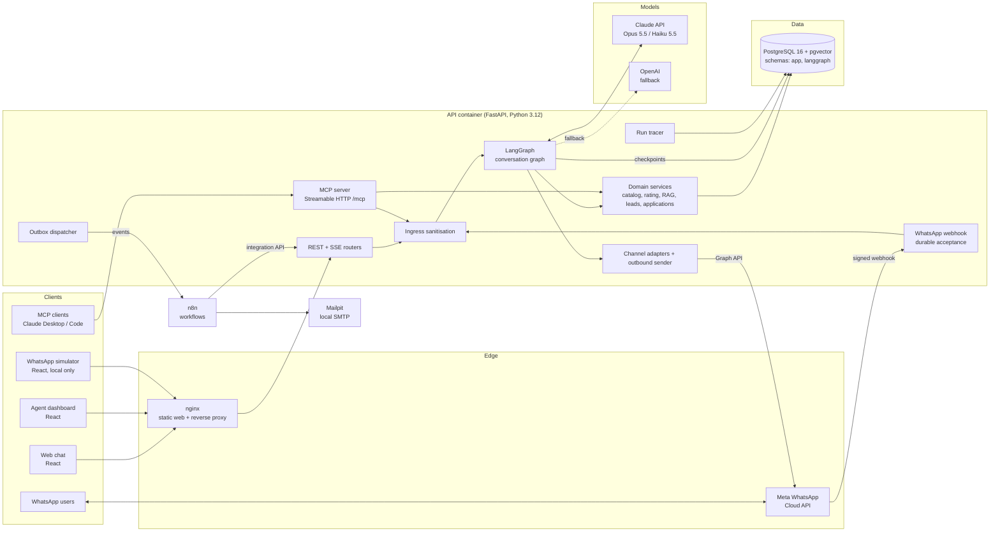
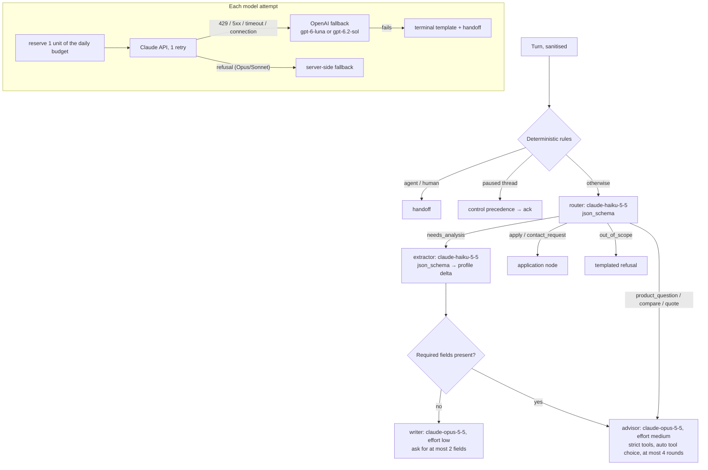

# Architecture overview

PolicyPilot is an AI copilot for a multi-carrier insurance agency. It talks to customers on
web chat and WhatsApp, analyses their needs, compares products from several fictional
carriers, answers questions from policy wordings with citations, shows indicative quotes from
a deterministic engine, and drafts applications. A licensed human agent reviews and approves
anything binding in a dashboard. The same capabilities are exposed to other AI agents through
an MCP server, and staff automations run in n8n.

The decisions behind this page are in [the ADRs](../adr/README.md). The detailed designs are
linked at the end. The design was revised after an independent review
([review 01](../reviews/01-docs-review.md)).

## Components



| Component | Responsibility | Tech |
|---|---|---|
| Web app | Customer chat, WhatsApp simulator, agent dashboard, privacy notice | React 19, Vite, TanStack Query, Tailwind, i18next (ADR-0016) |
| API | REST, SSE progress and validated replies, webhooks, MCP, auth | FastAPI 0.165 with built-in SSE |
| Ingress sanitisation | Removes identifiers and health details before storage or models; hides contact details from models | Deterministic detectors (security-and-privacy.md) |
| Conversation graph | Routing, needs analysis, advice, quoting, applications, handoff, guardrails, review interrupts | LangGraph 1.2 with `AsyncPostgresSaver` (ADR-0005) |
| Domain services | Catalog, deterministic rating, retrieval, leads, applications and snapshots, audit | Python, SQLAlchemy 2.1 (ADR-0003) |
| Retrieval | Hybrid pgvector and full-text search over versioned policy PDFs | pgvector HNSW, fastembed bge-small (ADR-0008) |
| Channel adapters | Render replies per channel; durable outbound delivery; the WhatsApp 24-hour window | httpx to Graph API v27.0 (ADR-0009) |
| MCP server | Catalog, quote and lead tools for other agents | Official `mcp` 2.3 SDK, Streamable HTTP (ADR-0010) |
| Outbox and n8n | Reliable domain events to staff automations | Transactional outbox, n8n 2.48 (ADR-0012) |
| Observability | Per-run traces in Postgres, JSON logs with PII masking | structlog, LangChain callbacks (ADR-0011) |
| Database | Everything persistent | PostgreSQL 16 with pgvector 0.8 (ADR-0004) |

Everything runs locally with `docker compose up`. The services are `db`, `migrate`, `seed`, `api`,
`web` (nginx), `n8n-import`, `n8n` and `mailpit`. The AWS plan is in
[aws.md](../deployment/aws.md).

## Flow 1: web chat turn

```mermaid
sequenceDiagram
  autonumber
  participant B as Browser
  participant A as API
  participant DB as Postgres
  participant G as LangGraph
  participant M as Claude

  B->>A: POST /api/v1/chat/sessions/{id}/messages {text, clientMessageId}
  A->>A: sanitize(text) → stored_text, model_text
  A->>DB: insert turn (unique clientMessageId) + customer message
  A->>DB: pg_try_advisory_lock(conversation) on a dedicated connection
  alt lock busy
    A-->>B: 409 turn_in_progress
  end
  A-->>B: SSE turn.started
  A->>G: astream(model_text, thread_id=conversation)
  G->>M: route (Haiku, json_schema)
  G->>M: advisor (Opus, strict tools)
  M-->>G: tool calls: quote_products, search_policy_documents
  G->>DB: rate with the deterministic engine, persist quotes, retrieve chunks
  G-->>A: custom events
  A-->>B: SSE status ("Calculating quotes…"), artifact.quote (from stored quotes)
  M-->>G: draft reply with {{quote:id}} placeholders and [doc:id] markers
  G->>G: guard_output: repair once → final deterministic validation → template fallback
  G->>DB: checkpoint, compact history
  A->>DB: store validated assistant message, trace, turn completed; unlock
  A-->>B: SSE message.delta (validated text chunks) … message.completed {token}
```

- No model-written text reaches the browser before validation. Progress events and quote cards
  built from the database stream during the run.
- If the client disconnects, the turn still completes, and the client recovers it with
  `GET …/messages?after=`. A retry with the same `clientMessageId` never runs the turn twice.

## Flow 2: WhatsApp turn

```mermaid
sequenceDiagram
  autonumber
  participant U as Customer (WhatsApp)
  participant META as Meta Cloud API
  participant A as API /webhooks/whatsapp
  participant DB as Postgres
  participant DR as Drainer
  participant G as LangGraph
  participant SND as Outbound sender

  U->>META: message
  META->>A: POST webhook (X-Hub-Signature-256)
  A->>A: verify HMAC over raw body; parse; sanitize text
  A->>DB: INSERT inbound_events ON CONFLICT DO NOTHING (commit)
  A-->>META: 200 (only after commit; 503 if the insert fails → Meta retries)
  A->>DR: nudge(conversation)
  DR->>DB: try-lock conversation; take pending events in (received_at, id) order
  DR->>G: run turn
  G-->>DR: validated reply + artifacts
  DR->>DB: store assistant message + outbound_messages (pending)
  SND->>META: POST /v27.0/{phone_number_id}/messages (template if outside 24h)
  META->>U: reply
  META->>A: status webhooks → outbound_messages status
```

Locally, `WHATSAPP_MODE=simulator`: the simulator page posts correctly signed, Meta-shaped
payloads to the same webhook. The `/dev` routes exist only in local simulator mode
([whatsapp.md](../design/whatsapp.md)).

## Flow 3: human approval (interrupt and resume)

```mermaid
sequenceDiagram
  autonumber
  participant Cu as Customer
  participant G as LangGraph
  participant DB as Postgres
  participant N as n8n
  participant Ag as Human agent (dashboard)

  Cu->>G: "Yes, submit my application"
  G->>DB: freeze application snapshot v1
  G->>DB: prepare_review (idempotent by review_key): task, outbox event, statuses
  G->>G: human_review: interrupt(payload) (no other side effects)
  G->>DB: checkpoint (paused)
  G-->>Cu: "An agent will review your application."
  DB-->>N: application.submitted → staff email
  Cu->>DB: "any news?" (stored; control rules; ack template, no graph run)
  Ag->>DB: claim task, read snapshot + messages since the task opened
  Ag->>G: resolve {approve} → task resolving → Command(resume={decision, intervening messages})
  G->>DB: finalize_review (idempotent): application approved, audit, application.reviewed event
  G->>DB: decision message (WhatsApp outbound or web message)
  Cu->>DB: web client polls GET …/messages?after= → sees the decision
```

Handoff uses the same mechanism with `kind: handoff`. While paused, STOP, withdrawal and
escalation requests are handled deterministically before the acknowledgement. Recovery from a
failed resume is described in [agent-design.md](../design/agent-design.md#resolving).

## Multi-model routing and fallback



- Each role (`router`, `extractor`, `advisor`, `writer`) is configured separately (ADR-0006).
  Structured output always uses `method="json_schema"`, and tools use `strict=True` with `auto`
  choice.
- Every fallback, guardrail action and terminal reply is recorded on the run trace.
- `LLM_PROVIDER=fake` swaps every role for the scripted demo model (ADR-0017). It is the default
  without an API key, and the UI says so.

## Trust boundaries

| Boundary | Control |
|---|---|
| Browser → API | Conversation-scoped JWT with a revocation version, or agent JWT; CORS; rate limits including session creation |
| Meta → API | HMAC-SHA256 over the raw body; durable deduplication; `/dev` simulator routes mounted only in local simulator mode |
| MCP clients → API | Hashed opaque API tokens with scopes; quote rate limits; host and origin allow-lists |
| n8n ↔ API | Shared header token on events; `integrations`-scoped token with idempotent callbacks |
| Everything → storage, models, logs | Ingress sanitisation first; models never see contact details, identifiers or health details |
| Retrieved documents → model | Delimited as reference material; the model is told never to follow instructions in them |
| Model → customer | Final deterministic validation before anything is shown |

## Detailed designs

- [Data model](../design/data-model.md)
- [Catalog, seed data and rating engine](../design/catalog-and-rating.md)
- [Agent design: graph, state, interrupts, checkpointing, concurrency](../design/agent-design.md)
- [API contracts and routing matrix](../design/api.md)
- [MCP server](../design/mcp-server.md)
- [WhatsApp channel](../design/whatsapp.md)
- [n8n workflows and events](../design/n8n.md)
- [Security, guardrails and PII](../design/security-and-privacy.md)
- [Testing and evals](../design/testing-and-evals.md)
- [Observability](../design/observability.md)
- [Compliance notes](../compliance.md)
- [Local development and monorepo layout](../development.md)
- [AWS deployment plan](../deployment/aws.md)
