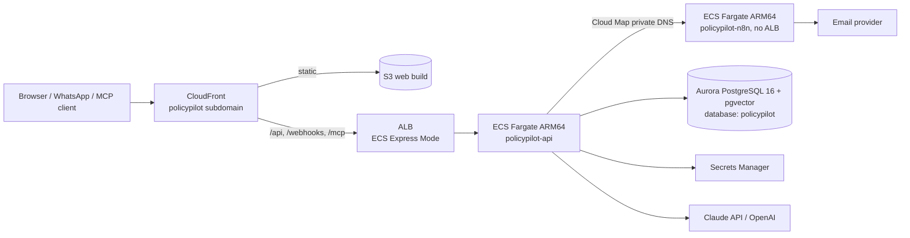

# AWS deployment plan

Status: **plan only.** Nothing has been deployed. Phase 1 runs locally with Docker Compose. This
document describes how PolicyPilot is meant to run on AWS, and why it can start on an existing
Aurora PostgreSQL cluster that another project already uses. The account-specific inventory of
that other project is kept out of this repository.

Unit prices are us-east-1 on-demand list prices checked on 2026-11-20. Use the AWS Pricing
Calculator before committing.

## Target architecture

| Concern | Choice | Why |
|---|---|---|
| API compute | ECS Express Mode service on Fargate (ARM64, 0.5 vCPU, 1 GB) | Managed ALB, HTTPS and deployments with no extra charge. App Runner has been closed to new customers since 2026-04-30. |
| n8n | A plain Fargate service (0.25 vCPU, 1 GB) with ECS service discovery, **no load balancer** | The editor is never public. The API reaches it at `n8n.policypilot.internal`. The owner opens the editor through ECS Exec port forwarding. |
| Networking | Public subnets with public IPv4 for egress; no NAT gateway | A NAT gateway would add $32.85 a month plus $0.045/GB. Task security groups accept traffic only from the ALB (API) or the API (n8n). |
| Edge | CloudFront with a dedicated distribution and ACM certificate | Its own CSP and cache rules. SSE survives the 30-second origin read timeout because the API sends a keep-alive every 15 seconds. |
| Database | A `policypilot` database on an existing Aurora PostgreSQL Serverless v2 cluster (see below), or a standalone RDS instance | One `pg_dump` moves it from one to the other. |
| Secrets | Secrets Manager, with resource policies limited to the task role | No long-lived keys in environment files. |
| Deployments | GitHub Actions with OIDC, ARM64 images in ECR, CDK in Python (`infra/cdk`, a later phase) | No stored cloud credentials. |
| n8n storage | SQLite on task storage, with workflows and credentials re-imported at every start | n8n never holds a connection to the shared database (n8n.md). |

## Starting on a shared Aurora cluster

Aurora Serverless v2 with a minimum capacity of 0 **pauses** after a configurable idle period and
bills no compute while paused. Resuming takes about 15 seconds, or 30 seconds or more after a day
paused. **Any open user connection prevents pausing.** That one rule decides whether sharing saves
money.

### Isolation

- A separate **database** (`policypilot`), a separate **owner role** for migrations and a separate
  **app role** for runtime, each with its own Secrets Manager secret.
- `REVOKE CONNECT … FROM PUBLIC` on both databases, so neither project's roles can connect to the
  other's database. Per-role `CONNECTION LIMIT`, `statement_timeout` and
  `idle_in_transaction_session_timeout`.
- One security-group ingress rule on port 5432, from PolicyPilot's task security group only. The
  rule is owned by PolicyPilot's stack.
- PolicyPilot's CDK app **references** the shared cluster and VPC by ID, never modifies the other
  project's stack, and adds only resources it owns (public subnets, an internet gateway, rules).
- A one-time bootstrap, run with the cluster's admin credential, creates the database, the roles
  and the `vector` extension. PolicyPilot's migrations never create extensions, and they refuse to
  run unless `current_database()` is `policypilot` (ADR-0004).

### Idle discipline built into the code

- Connection pools use `min_size=0` and close idle connections after 60 seconds.
- The outbox dispatcher and the WhatsApp drainer are event-driven, so an idle system sends no
  queries at all.
- The load-balancer health check (`/healthz`) never touches the database.
- Browser polling (dashboard, paused chat, simulator) runs only while the tab is visible and stops
  after 15 minutes without user activity.
- Scheduled n8n jobs call the API at most every 6 hours, and only in business hours.
- WhatsApp webhooks are stored durably before the `200`. A webhook that arrives while the cluster
  resumes may get a `503`; Meta retries for up to 7 days, and duplicates are absorbed by a unique
  key. The reply is delayed, never lost.

### Risks

| Risk | Mitigation |
|---|---|
| The cluster never pauses: about $43.80 a month at the 0.5 ACU floor, paid by both projects | The idle discipline above, plus an alarm on capacity above 0 for more than 2 hours |
| A runaway query scales the cluster for both projects | Statement timeouts, `LIMIT`s on retrieval, and an ACU alarm |
| Shared `max_connections` | Per-role connection limits and small pools |
| The cluster admin credential can read every database | Accepted for a demo with synthetic data. Moving out is the long-term fix. |
| pgvector versions follow the cluster engine version | Only HNSW and cosine operators are used (available since pgvector 0.5). Engine upgrades are coordinated. |
| Migrations against the wrong database | The `current_database()` guard, role grants, and separate secrets |
| Point-in-time restore covers the whole cluster | Restore into a temporary cluster and `pg_dump` the one database. A nightly logical dump is planned. |
| Cost attribution | Compute caused by PolicyPilot is billed to the shared cluster. Keep an account-level budget, plus a tag-filtered PolicyPilot budget for its directly attributable costs. |

## Estimated monthly cost

These figures cover 730 hours and exclude model tokens, free tiers and taxes.

| Item | Monthly |
|---|---|
| ALB (Express Mode) and LCUs | about $17.40 |
| ALB public IPv4 × 2 | $7.30 |
| API task, 0.5 vCPU / 1 GB ARM | $14.42 |
| n8n task, 0.25 vCPU / 1 GB ARM | $8.51 |
| Task public IPv4 × 2 | $7.30 |
| Secrets Manager × 3, Cloud Map, logs, ECR, S3 and CloudFront | about $3.30 |
| **Compute and edge subtotal** | **about $58** |

| Database option | Extra per month | Total |
|---|---|---|
| Standalone RDS db.t4g.micro with 20 GB gp3 | $13.98 | about $72 |
| Shared Aurora, mostly idle (about 20 active hours plus wake-ups every 6 hours, at 0.5 ACU) | about $2–4 | about $60–62 |
| Shared Aurora, dashboard in use during business hours (about 176 extra hours at 0.5 ACU) | about $12–14 | about $71–73 |
| Shared Aurora with connections always open | about $43.80 | about $102 |

Unit prices used: Fargate ARM64 $0.03238 per vCPU-hour and $0.00356 per GB-hour; ALB $0.0225
per hour; public IPv4 $0.005 per hour; RDS db.t4g.micro $0.016 per hour; gp3 $0.115 per GB-month;
Aurora Serverless v2 $0.12 per ACU-hour.

**Conclusion:** sharing an existing cluster saves about $10 a month while PolicyPilot is a
mostly idle demo. Once agents use it every day, a standalone instance costs the same and isolates
the blast radius. Sharing is the right start, and moving out is the planned next step.

A cheaper alternative is a single EC2 t4g.medium running the same `docker-compose.yml` behind
CloudFront, which costs about $36 a month including a shared database. It is simpler, but it is
one host that has to be patched.

## Moving to standalone infrastructure

1. Deploy the CDK app with `--context mode=standalone`. It creates its own VPC (public subnets, no
   NAT) and an RDS instance or its own Aurora cluster.
2. Scale the API to 0, run `pg_dump -Fc -d policypilot` against the shared cluster, and
   `pg_restore` into the new database. LangGraph checkpoints are included, so paused reviews survive.
3. Point the database secrets at the new endpoint and redeploy into the new VPC.
4. Remove the ingress rule, drop the database and roles from the shared cluster, and delete
   PolicyPilot's subnets and internet gateway from the shared VPC.

The expected downtime is a few minutes.
