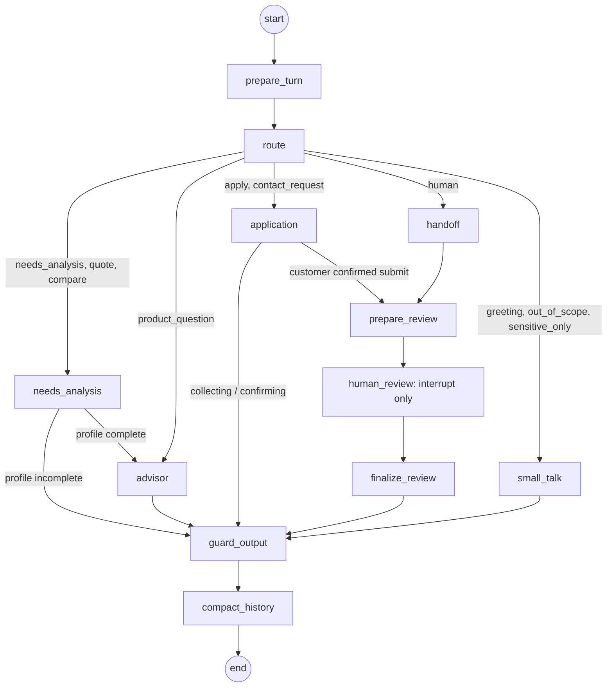

# Agent design

This document covers the LangGraph conversation graph: nodes, state, tools, prompts,
guardrails, interrupts, checkpointing, concurrency and streaming. The decisions behind it
are in ADR-0005, ADR-0006 and ADR-0017. It was revised after the Codex docs review
(`docs/reviews/01-docs-review.md`).

## Where the graph sits in a turn

A **turn** is one customer message and the assistant's reply. Every turn goes through the
same server-side pipeline, whatever the channel:

1. **Ingress sanitisation** (`policypilot.security.ingress.sanitize`) runs before anything is
   stored, logged, traced or checkpointed (security-and-privacy.md). It returns:
   - `stored_text`: sensitive identifiers (card, IBAN, national ID) and volunteered health
     details are redacted;
   - `model_text`: `stored_text` with emails and phone numbers also masked. **The graph only ever
     receives `model_text`.**
   - `redactions`: the types and counts that were redacted.
2. **Turn registration.** A `turns` row is created with `(conversation_id, client_message_id)`
   unique, and the customer message is stored. A retried request with the same
   `client_message_id` gets the existing turn: its result if it completed, or `409
   turn_in_progress` if it is still running.
3. **The conversation lock** is taken (see Concurrency below).
4. **Control handling.** Deterministic rules run before the graph (see Paused conversations below).
5. **The graph runs:** `graph.ainvoke(...)`, or `astream` for progress events, with
   `thread_id = conversation_id`.
6. **Delivery.** The validated reply and its artifacts are stored as an assistant message. An
   outbound delivery intent is recorded for WhatsApp. The turn is marked `completed` and the
   lock is released.

On failure at step 5, the turn is marked `failed`. The customer message stays, no assistant
message is stored, and a fixed error template is shown with a "Try again" action that reuses
the same `client_message_id`. Quotes created before the failure remain; they are append-only
and harmless. LangGraph keeps the last successful super-step, and the next turn continues from it.

## Graph



| Node | Model | What it does |
|---|---|---|
| `prepare_turn` | none | Resets the per-turn fields and copies the ingress `redactions` into `flags`. The text is already sanitised. |
| `route` | `router` (Haiku 5.5) | Deterministic rules come first: the keywords "agent"/"human" → `human`; a message that was only a redacted identifier → `sensitive_only`; an application in `changes_requested` → `apply`. Otherwise `RouteDecision` is produced with structured output: `intent`, `line`, `confidence`. A confidence below 0.5, or a parse failure, falls back to `needs_analysis`. |
| `needs_analysis` | `extractor` (Haiku 5.5), `writer` (Opus 5.5, low) | Extracts a `ProfileDelta` with structured output and merges it with deterministic validation. It computes the missing **required fields** (table below). If any are missing, the writer asks for at most two in one message. Otherwise control passes to the advisor. Quote and compare requests pass through here too, so a correction in the same message ("actually I'm 50") reaches the profile before anything is priced. |
| `advisor` | `advisor` (Opus 5.5, medium) | A bounded tool loop, at most 4 model rounds and 8 tool calls (tools below). If the last round still requests tools, it is called once more **without tools**, which forces a text answer. |
| `application` | `writer` (and `extractor` at the summary) | A state machine (below). Contact details are parsed **deterministically** from `stored_text` by the service layer, never by the model. Consent and submission need an unambiguous yes: any negation ("no, don't submit") counts as no. At the summary a correction is extracted; if the rating inputs changed or the quote expired, a fresh quote is made and the customer must confirm the new summary. |
| `handoff` | `writer` | Writes a short summary of the model-visible history for the agent. If no model can be called (budget spent, provider failure), a deterministic summary is used instead, so a person is always reachable. |
| `prepare_review` | none | Creates the review artefacts **idempotently** (see Interrupts below). |
| `human_review` | none | `decision = interrupt(payload)`, with no other side effects. |
| `finalize_review` | none | Applies the decision idempotently, keyed by `review_task_id`. It composes the customer message from templates plus the agent's optional note, which is sanitised at ingress like any other text. |
| `small_talk` | none | Templated replies in the conversation locale: greeting, out-of-scope, sensitive-data warning. |
| `guard_output` | `writer` (one repair, optional) | Repair, then final deterministic validation (see Output guardrails below). |
| `compact_history` | `writer` (every 10 turns) | Bounds the size of the model context and the checkpoint (see Checkpointing below). |

## State

The state is a `TypedDict`. Everything in it is JSON-serialisable, and none of it holds raw
sensitive identifiers, emails or phone numbers.

```python
class ConversationState(TypedDict):
    messages: Annotated[list[AnyMessage], add_messages]   # model-visible history (model_text only)
    history_summary: str                                  # rolling summary of compacted turns
    conversation_id: str
    turn_id: str
    channel: Literal["web", "whatsapp"]
    locale: str                                           # BCP 47, e.g. "en"
    profile: dict                                         # CustomerProfile.model_dump()
    route: dict | None                                    # RouteDecision
    turn_quote_ids: list[str]                             # quotes produced this turn
    turn_chunk_ids: list[int]                             # chunks retrieved this turn
    turn_product_ids: list[str]                           # products returned by tools this turn
    artifacts: list[dict]                                 # validated quote cards, comparisons
    citations: list[dict]                                 # resolved citations for this turn
    application: dict | None                              # ApplicationDraft (IDs and step, no contact values)
    review: dict | None                                   # PendingReview while interrupted
    flags: dict                                           # redactions, fallback_used, guardrail_actions
    reply: str | None                                     # final validated reply
```

### Required profile fields per line

| Line | Required to quote | Optional (improves search) |
|---|---|---|
| life | `age` (18–65), `coverage_goal_minor`, `term_years` (10, 20 or 30) | `monthly_budget_minor`, `household_size`, `dependents` |
| health | `age` (18–64), `region`, `dependents` (0–8) | `monthly_budget_minor`, `tier_preference` |
| auto | `driver_age` (18–85), `vehicle_class`, `annual_mileage_band`, `claims_last_5y` (0–4) | `monthly_budget_minor`, `coverage_level` |

Budgets are always monthly. Annual auto premiums are compared on their monthly equivalent. The
profile **never** holds smoking status, gender, health conditions, identifiers or contact details.
Life quotes always show both smoker and non-smoker variants (ADR-0003).

## Tools (advisor)

The tools wrap the domain services that the MCP server also uses (ADR-0010). They are bound with
`strict=True` and `tool_choice="auto"`. Every tool records what it returned in the turn fields,
which the guardrails then check.

| Tool | Input | Output |
|---|---|---|
| `search_products` | `line`, optional `must_have` (attribute keys), `limit` | **Catalog discovery, no prices:** ID, carrier, name, attributes, summary |
| `quote_products` | `line`, optional `max_monthly_budget_minor`, optional `product_ids` | **Profile-aware pricing:** rates every eligible product of the line from the current profile, sorted by monthly equivalent and filtered by budget. Life products are limited to the profile's `term_years`. Returns quote IDs. Ineligible products are listed with their reasons. If nothing fits the budget, it returns the cheapest eligible quote with `over_budget: true`. Fails with `missing_fields` if the profile is incomplete. |
| `get_quote` | `product_id`, optional `coverage_goal_minor` override stated by the customer this turn | One quote from the profile, or an ineligibility reason |
| `compare_products` | `product_ids` (2–4) | An attribute matrix plus the turn's quotes for those products, if any. Adds a `comparison` artifact. |
| `search_policy_documents` | `query`, optional `product_id` | Up to 6 chunks of **current** document versions, wrapped in `<document id=… product=… section=… pages=…>` tags. Without `product_id`, the search is limited to the products the customer named this turn, if any. |

The rating inputs always come from the validated profile. The model can only choose products
and pass a coverage override that the customer stated. Quote operations are idempotent per
`(turn_id, product_id, inputs hash)`, so a retried tool call returns the same quote.

## Application state machine

| Step | Customer sees | Exit |
|---|---|---|
| `confirm_product` | The chosen quote card | Yes → `collect_contact`; another product → back to the advisor |
| `collect_contact` | "Your name, and an email or phone number, so an agent can contact you." | Valid `name` plus `email` or `phone`, parsed by the service from `stored_text` and stored on the lead, never in state |
| `consent` | Purpose statement plus a privacy notice link (`/privacy`): "May a licensed agent contact you about this application?" | Explicit yes → consent evidence stored on the lead; no → lead discarded |
| `summary` | The application summary (product, estimate, needs), with contact details masked | `submit` / `change` / `agent` |
| `confirm_submit` | Buttons: Submit / Change details / Talk to agent | Submit → `prepare_review` |

A `contact_request` ("Can someone call me?") uses `collect_contact` and `consent` only, and then
creates a lead with no application (`lead.created`). Marketing opt-in is separate, never asked
in Phase 1, and stays false.

On submit, the service freezes an **application snapshot** (`application_snapshots`, version
N). It holds the applicant fields, the needs profile, the quote ID and its rate-table version,
the product, and the policy-document version. The snapshot is what the agent reviews and what
"approved" refers to (data-model.md).

## Output guardrails (`guard_output`)

Order: **(1) at most one model repair, (2) final deterministic validation, (3) template
fallback.** Nothing the model writes reaches the customer until step 2 passes.

1. **Repair (optional, one attempt).** If the draft contains banned claims, the writer rewrites it
   with an instruction to remove them, and only the rewrite goes forward.
2. **Final validation.** These checks all run on the text that will actually be sent:
   - **Money:** the model must not write premiums. It writes placeholders, `{{quote:<id>}}`, which
     the server renders from the stored quote with product, period and label, for example
     "$75.00 per month (estimate)" or "$1,628.00 per year (about $135.67 per month, estimate)".
     **Every other number** in the draft is extracted (digits with or without a currency sign,
     percentages, numbers written in words; placeholders, citation markers and product names are
     blanked first) and must be accounted for (`agents/numbers.py`, `guardrails.unaccounted_numbers`):
     - the **kind** of a number comes from the words next to it. A period right after it ("a
       month", "per year"), or a price word right before it ("costs 80", "the premium is about
       80", "9 is the price") makes it a price, unless a unit or attribute noun is attached
       ("pay a $6,000 deductible", "pay within 30 days"). In a sentence with any other price
       word ("cost", "premium", "price", "pay", "runs", "rate", "quote"), a number is a price
       unless it is marked:
       - a unit or label, shared along a list or range ("31 days", "a 30-year term", "clause
         4.1", "aged 18 to 64", "10, 20 and 30 year", "Dec 20, 2026");
       - an attribute or cover noun attached ("a $6,000 deductible", "an out-of-pocket maximum
         of $9,000", "$500,000 of cover", "the first $1,000 of a claim");
       - a count noun or determiner ("the two prices", "three plans", "recommend one");
       - "for" before the cover goal ("a quote for $500,000");
       - or the sentence is about a deductible-type term and has no price noun.
     - a **money** number (a currency marker, or a price) is never a premium. The customer's
       budget passes only in a sentence about the budget that names no product; the cover goal
       only with cover words or a cover mark; a product attribute (such as a deductible) or an
       amount from the retrieved policy text only when it is not a price;
     - a **percentage** must be a fact of the turn;
     - a **plain** number must be a fact of the turn (profile values; attributes, summaries,
       highlights and eligibility limits of the products returned, quoted or named; the
       retrieved policy text; the field hints being asked; numbers the customer wrote), a count
       up to 12, or part of a date.
     Anything else fails, and the trace step of the fallback records the offending sentences.
     Templated drafts (fixed texts filled with stored values) skip this check.
   - **Placeholders:** each `{{quote:<id>}}` must refer to a quote in `turn_quote_ids`, and if its
     line or sentence names products, the quote's product must be one of them.
   - **Citations:** each `[doc:<id>]` marker must refer to a chunk in `turn_chunk_ids`. When the
     customer named products, every cited chunk must belong to one of them. `route` finds named
     products by code, not by a model (`services/catalog.mentioned_products`): a carrier name is
     required, and further name words ("gold", "20", "comprehensive") narrow it down, so "the
     Kestrel policy" means the Kestrel products and "Solace Gold" means one product.
     A policy answer with **no** valid citation is replaced by the `insufficient_evidence`
     template; it is not delivered with a disclaimer.
   - **Banned claims:** checked again, after the repair.
   - **Disclaimer:** present whenever quotes are shown; appended if missing.
   - **Channel limits:** length and formatting.
3. **Template fallback.** If validation fails, the reply is built only from templates and
   artifacts: quote cards and comparison data come from the database, plus a fixed sentence. Every
   action is a `guardrail` trace step.

## Interrupts and resume

### Creating a review (replay-safe)

`human_review` is re-executed from the start on resume, so it does only one thing: call
`interrupt()`. All side effects happen earlier, in `prepare_review`, keyed by a stable
`review_key`:

- `application:<application_id>:v<snapshot_version>` for an application review;
- `handoff:<conversation_id>:<turn_id>` for a handoff.

In one transaction, `prepare_review`:

1. `INSERT … ON CONFLICT (review_key) DO NOTHING` the `review_tasks` row;
2. inserts the outbox event with `id = uuid5(NAMESPACE, review_key + ":submitted")`, using
   `ON CONFLICT DO NOTHING`;
3. sets `applications.status = pending_review` and `conversations.status = awaiting_review`
   (or `human_takeover` for a handoff).

Running it twice is a no-op. A partial unique index allows **one unresolved task** (`open`,
`claimed` or `resolving`) per conversation.

### Resolving

`POST /api/v1/agent/review-tasks/{id}/resolve` takes the conversation lock, then:

1. moves the task from `claimed` to `resolving` and records the decision. This is a compare-and-set:
   a task that is already `resolving` or `resolved` returns `409`;
2. collects the **intervening customer messages** (customer messages stored since the task was
   created) from `app.messages` and adds them to the resume value;
3. calls `graph.ainvoke(Command(resume=decision), {"configurable": {"thread_id": conversation_id}})`;
4. `finalize_review` applies the decision idempotently: application status, the audit entry, and
   the outbox event `uuid5(review_key + ":resolved")`. It then sets the task to `resolved` and the
   conversation to `active` or `closed`.

The valid decisions are:

| Kind | Action | Rules |
|---|---|---|
| `application_review` | `approve` | Allowed only if the snapshot's quote has not expired. An expired quote must be re-quoted (`request_changes`). |
| `application_review` | `request_changes` | Sends the agent's note. The application returns to `changes_requested`, and the next turn routes to `application`. |
| `application_review` | `reject` | Sends the agent's note. The application becomes `rejected`. |
| `application_review` | `edit_and_approve` | Only for **clerical fields** (name spelling, contact formatting). It creates snapshot N+1. Edits to product, rating inputs or needs are refused (`422 requires_customer_confirmation`); use `request_changes`. |
| `handoff` | `return_to_assistant` | The conversation returns to the assistant. |
| `handoff` | `close` | The conversation is closed. |

**Recovery:** if step 3 or 4 fails, the task stays `resolving` and the dashboard shows "resume
failed — retry". `policypilot maintenance reconcile-reviews` compares tasks, applications and
`aget_state().interrupts` for every non-active conversation. It re-runs the resume when the graph
is still interrupted, or completes `finalize_review`'s idempotent writes when the graph has
already moved on.

### Paused conversations: control precedence

While a conversation is `awaiting_review` or `human_takeover`, new customer messages do **not**
invoke the graph. They are stored, and deterministic rules apply in this order:

1. **STOP** (WhatsApp) or "stop messaging me": opt-out. The open task gets a note, no further
   proactive sends are made, and the customer gets a confirmation.
2. **"withdraw" / "cancel my application"** during an application review: the task resolves as
   `withdrawn`, and the graph is resumed with `{action: "withdraw"}`. The application becomes `withdrawn`.
3. **"agent" / "human"** during an application review: the task's priority is raised and a note is
   added. The customer is told an agent is already reviewing.
4. **Anything else:** in `awaiting_review`, the `review_pending_ack` template is sent, at most once
   per 10 minutes. In `human_takeover`, nothing is sent automatically; the agent sees the message.

Every message stored while paused is passed to the graph on resume (step 2 of Resolving above).

## Checkpointing and history

- `AsyncPostgresSaver` runs on its own `AsyncConnectionPool` with `min_size=0`, `max_size=5` and
  `max_idle=60`. Connections use `autocommit=True`, `row_factory=dict_row`, `prepare_threshold=0`
  and `options=-c search_path=langgraph`. `setup()` runs in `policypilot db upgrade`, never at
  API start-up.
- **Model-visible history:** the last 12 messages, with the window boundary moved so that a
  tool-call/tool-result pair is never split, plus `history_summary` and the profile.
- **`compact_history`** runs at the end of every turn. It keeps checkpoint growth bounded:
  - tool results from earlier turns are replaced by stubs (`ToolMessage` with the same
    `tool_call_id`, content "[result omitted; see quote/chunk IDs]"), using `RemoveMessage` and a new
    message, so pairs stay valid;
  - every 10 turns the writer folds messages older than the last 12 into `history_summary`, and those
    messages are removed from state;
  - at most 40 messages ever stay in state.
  The full transcript is always in `app.messages`.
- A test asserts that after 50 scripted turns the checkpoint stays below 64 KB and that every
  `AIMessage` with tool calls is followed by its results.

## Concurrency: one lock protocol

All writers to a conversation use the same lock: turns, review resolution, human replies,
closure and erasure.

- The lock is a **session advisory lock** on a **dedicated connection checked out from the pool for
  the whole operation**: `pg_try_advisory_lock(hashtextextended('conv:' || id, 0))`. It is released
  with `pg_advisory_unlock` in `finally`. If the process dies, the connection closes and Postgres
  releases the lock.
- **Web** uses a non-blocking try-lock. If it fails, the response is `409 turn_in_progress`.
- **WhatsApp** inbound events are processed by a per-conversation **sequential drain**:
  1. a worker takes the lock (non-blocking; if it fails, another worker is already draining that
     conversation);
  2. it processes `inbound_events` for that conversation in `(received_at, id)` order until none
     are pending;
  3. it releases the lock.
  Arrival order is therefore the order in which events are stored durably.
- **Review resolution and human replies** use try-lock, retried for up to 10 seconds, then
  return `409 conversation_busy`.
- Tests cover lock release after cancellation, timeouts and an exception inside the graph.

## Model calls: limits, retries, fallback and exhaustion

| Role | Timeout per attempt | SDK retries | Max output tokens |
|---|---|---|---|
| `router`, `extractor` | 15 s | 1 | 512 |
| `advisor` | 45 s | 1 | 2,048 |
| `writer` | 30 s | 1 | 800 |

- **Turn deadline:** 90 s overall, enforced with `asyncio.timeout`.
- **Budget:** each model call (one LangChain call, including fallback calls, summaries and
  repairs; the SDK's own transport retry is not counted separately) first reserves one unit from
  `llm_usage_counters` atomically (data-model.md). The scripted demo model is not counted. When none are left, the turn ends
  with the `rate_limited` template, which tells the customer to type "agent"; that handoff needs no
  model call.
- **Fallback:** after the primary provider's retries fail with a transport error, 429 or 5xx,
  the call goes once to the fallback provider (ADR-0007).
- **Exhaustion:** when both providers fail, a structured output cannot be parsed after one retry,
  or the turn deadline passes, the turn ends with a deterministic terminal reply. The `assistant_unavailable`
  template offers an agent (typing "agent" opens a handoff without a model call). Any artifacts
  already validated are still delivered.
- **Concurrency per process:** at most half the database pool executes at once (5 turns with the
  default pool of 10), because each turn holds a pooled connection for its conversation lock.
  Admission happens **before** the lock: excess web requests get `503 overloaded` with
  `Retry-After: 5` after a 2-second wait, and excess WhatsApp events wait in `inbound_events`.
- **Abandoned turns:** a turn still `running` when its conversation lock is free was abandoned
  (crash or cancellation). The next request under the lock marks it `failed` (`abandoned`), so the
  same `clientMessageId` can be retried.

## Delivering the reply (no unvalidated text)

The graph runs to completion before any model-written text is sent:

- **During the run**, the API streams **progress** over SSE: `status` events from tools through
  `get_stream_writer()`, for example "Searching 4 products…" or "Calculating quotes…". **Validated
  artifacts** (quote cards built from stored quotes) are streamed too.
- **After `guard_output`**, the validated reply is sent as `message.delta` events. These are
  chunks of the final text, sent quickly so the UI still feels like typing, and then
  `message.completed` follows.
- Model token streaming to the client is therefore **not** used. This trades a little latency for
  never showing text that would later be retracted. Typical turns take 2–6 seconds, with progress
  events throughout.

## Multi-agent framing

PolicyPilot is a **supervisor with specialists**:

- the router acts as supervisor;
- needs analysis, the advisor (itself a tool-using agent), the application clerk and handoff are
  the specialists;
- the human agent is the final authority, reached through interrupts.

Each specialist has its own prompt, model role and tools, and can be evaluated on its own.
