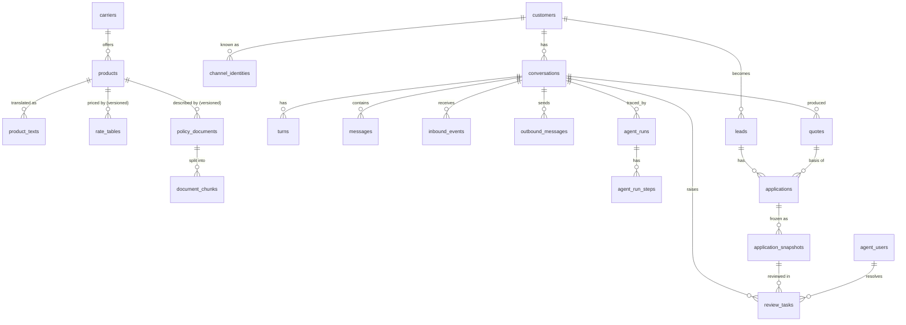

# Data model

PolicyPilot uses one PostgreSQL 16 database, `policypilot`, with two schemas (ADR-0004):

- `app`: the domain tables below, created by **Alembic** migrations in `apps/api/migrations/`;
- `langgraph`: the checkpoint tables, created by `AsyncPostgresSaver.setup()`. The checkpointer
  connects with `options=-csearch_path=langgraph`.

Conventions:

- Primary keys are `uuid` (`gen_random_uuid()`) unless noted.
- Timestamps are `timestamptz`, stored in UTC.
- Money is `bigint` minor units plus `char(3)` ISO 4217 currency.
- Enumerations are `text` with `CHECK` constraints, which are easier to migrate than PostgreSQL enums.
- Customer-facing text that may be translated lives in `*_texts` tables keyed by `(id, locale)` (ADR-0013).
- Data is fictional and synthetic only.
- The only extension required is `vector`. There is no `citext`; case-insensitive uniqueness uses
  `lower()` indexes.

## Entity overview

## Catalog

| Table | Columns | Notes |
|---|---|---|
| `carriers` | `id`, `code` (unique), `name`, `financial_strength`, `website` (`example.com` only), `active`, `created_at` | Fictional carriers only. |
| `products` | `id`, `carrier_id`, `code` (unique), `line` (`life` \| `health` \| `auto`), `currency`, `billing_period` (`monthly` \| `annual`), `attributes` jsonb, `active`, `created_at` | Attributes per line are listed in catalog-and-rating.md. |
| `product_texts` | PK (`product_id`, `locale`), `name`, `summary`, `highlights` text[], `exclusions_summary` | Customer-facing; falls back to `en`. |
| `rate_tables` | `id`, `product_id`, `version`, `effective_from` (date), `effective_to` (date, null = open-ended), `factors` jsonb, `checksum`, `published_at` (null = draft), `created_at` | Unique (`product_id`, `version`) and (`product_id`, `effective_from`). See the selection rule below. |

**Rate-table selection and immutability:**

- The table used at time `t` is the one with `published_at IS NOT NULL AND effective_from <= t
  AND (effective_to IS NULL OR t < effective_to)`.
- Publishing a table checks, in the service and in a constraint trigger, that its period does not
  overlap another **published** table of the same product. Publishing a successor closes the
  predecessor's `effective_to` in the same transaction.
- A published table cannot be updated or deleted: a trigger rejects it, and `quotes.rate_table_id`
  is `ON DELETE RESTRICT`.
- An unexpired quote keeps its own table. A newer table affects only new quotes. `factors` is
  validated by the line's Pydantic schema, and its decimals are stored as JSON **strings**
  (catalog-and-rating.md).

## Policy documents and retrieval

| Table | Columns | Notes |
|---|---|---|
| `policy_documents` | `id`, `product_id`, `locale`, `title`, `version`, `sha256`, `source_path`, `page_count`, `is_current`, `ingested_at` | Immutable versions. A partial unique index allows one `is_current` per (`product_id`, `locale`). |
| `document_chunks` | `id` (bigint identity, a stable citation ID), `document_id`, `chunk_index`, `section_ref`, `page_start`, `page_end`, `content`, `search` tsvector (generated, `english`), `embedding` `vector(384)`, `embedding_model`, `token_count` | HNSW index on `embedding vector_cosine_ops`, GIN on `search`. |

- **Ingestion:** a new or changed document (by `sha256`) is inserted as a new version with its
  chunks. In the **same transaction**, `is_current` moves from the old version to the new one. Old
  versions and their chunks are kept, so citations already stored in messages stay resolvable.
- Retrieval reads only current versions. Chunking rules are in catalog-and-rating.md.
- Retrieval is one SQL query: the top 20 by cosine distance and the top 20 by `ts_rank_cd`, fused
  with reciprocal rank fusion (`k = 60`), with optional `product_id`, `line` and `locale` filters,
  and `LIMIT 6`.

## Customers, channels, conversations and turns

| Table | Columns | Notes |
|---|---|---|
| `customers` | `id`, `display_name`, `email`, `phone_e164`, `locale` (default `en`), `region`, `marketing_opt_in` (false), `whatsapp_opted_out_at`, `created_at`, `erased_at` | Email and phone are set only from the application or contact flow, parsed from sanitised text by the service. |
| `channel_identities` | `id`, `customer_id`, `channel` (`web` \| `whatsapp`), `external_id`, `created_at`; unique (`channel`, `external_id`) | WhatsApp uses `user_id` when present, else `wa_id`. Web uses the conversation ID. |
| `conversations` | `id` (also the LangGraph `thread_id`), `customer_id`, `channel`, `status` (`active` \| `awaiting_review` \| `human_takeover` \| `closed`), `locale`, `last_customer_message_at`, `last_activity_at`, `ai_disclosed_at`, `token_version` (int, incremented to revoke tokens), `created_at`, `closed_at`, `close_reason` | Auto-closed after **30 days** without activity unless awaiting review (maintenance job). |
| `turns` | `id`, `conversation_id`, `client_message_id`, `status` (`running` \| `completed` \| `failed`), `customer_message_id`, `assistant_message_id`, `run_id`, `error_code`, `started_at`, `finished_at`; unique (`conversation_id`, `client_message_id`) | Turn identity and idempotency (agent-design.md). |
| `messages` | `id` (bigint identity, so the cursor is ordered), `conversation_id`, `role` (`customer` \| `assistant` \| `agent` \| `system`), `content` (the `stored_text`), `redactions` jsonb (types and counts only), `metadata` jsonb (citations, quote IDs, artifacts), `turn_id`, `created_at` | Sanitised before insert. Emails and phone numbers stay in `content` for the agent dashboard, but they never reach the model (`model_text`). |
| `inbound_events` | `id` (bigint identity), `channel`, `provider_message_id` (unique per channel), `conversation_id`, `kind` (`message` \| `button` \| `status` \| `unsupported`), `payload` jsonb (**sanitised** minimal fields, never the raw webhook), `received_at`, `status` (`pending` \| `processing` \| `done` \| `failed`), `attempts`, `last_error`, `processed_at` | Durable WhatsApp acceptance (whatsapp.md). Deduplication and processing state are separate fields. |
| `outbound_messages` | `id`, `conversation_id`, `channel`, `message_id` → messages, `kind` (`text` \| `template` \| `interactive`), `payload` jsonb, `status` (`pending` \| `sent` \| `delivered` \| `read` \| `failed`), `provider_message_id`, `attempts`, `next_attempt_at`, `last_error`, `created_at` | A delivery intent is recorded **before** sending and retried with backoff. Meta status webhooks update it by `provider_message_id`. |
| `simulator_outbox` | `id` (bigint identity), `conversation_id`, `to_external_id`, `payload` jsonb, `created_at` | Local WhatsApp simulator only. |

## Sales: quotes, leads, applications

| Table | Columns | Notes |
|---|---|---|
| `quotes` | `id`, `conversation_id`, `customer_id`, `product_id`, `rate_table_id` (RESTRICT), `inputs` jsonb, `inputs_hash`, `premium_minor`, `monthly_equivalent_minor`, `currency`, `billing_period`, `breakdown` jsonb, `variants` jsonb, `engine_version`, `source` (`assistant` \| `mcp` \| `agent`), `idempotency_key` (unique, nullable), `created_at`, `expires_at` (+30 days) | Append-only. Reproducible from `inputs` and `rate_table_id`. |
| `leads` | `id`, `customer_id`, `conversation_id`, `kind` (`application` \| `contact_request`), `status` (`new` \| `contacted` \| `qualified` \| `won` \| `lost`), `line_interest` text[], `profile` jsonb (needs snapshot at creation), `source`, `assigned_agent_id`, `next_follow_up_at`, `contact_consent_at`, `contact_consent_source` (`web` \| `whatsapp` \| `mcp`), `consent_text_version`, `created_at`, `updated_at` | Contact consent covers service contact only. Marketing is a separate field on `customers`. |
| `applications` | `id`, `lead_id`, `customer_id`, `conversation_id`, `product_id`, `quote_id`, `status` (`draft` \| `pending_review` \| `changes_requested` \| `approved` \| `rejected` \| `withdrawn` \| `expired`), `current_snapshot_version`, `created_at`, `updated_at` | `approved` means "ready for the agent to submit to the carrier"; nothing is bound in Phase 1. |
| `application_snapshots` | PK (`application_id`, `version`), `data` jsonb (applicant fields), `needs_profile` jsonb, `quote_id`, `rate_table_id`, `policy_document_id`, `created_by` (`customer` \| `agent:<id>`), `created_at` | **Immutable.** It is the customer-confirmed record that review decisions refer to, and the demands-and-needs record. |

Ownership is checked in the services. A quote used by an application must belong to the same
customer and conversation, and its product must match the application's product. An application's
lead and conversation must belong to the same customer.

## Human review

| Table | Columns | Notes |
|---|---|---|
| `review_tasks` | `id`, `review_key` (unique), `kind` (`application_review` \| `handoff`), `conversation_id`, `application_id`, `snapshot_version`, `status` (`open` \| `claimed` \| `resolving` \| `resolved`), `priority`, `summary`, `payload` jsonb, `claimed_by`, `claimed_at`, `decision` jsonb, `resolution` (`approved` \| `changes_requested` \| `rejected` \| `withdrawn` \| `returned` \| `closed` \| `expired`), `resolved_by`, `resolved_at`, `created_at` | Partial unique index: one task per conversation with `status IN ('open','claimed','resolving')`. Pending reviews older than **14 days** expire (maintenance job): the application becomes `expired` and the customer is told on their next visit. |

## People, access, limits

| Table | Columns | Notes |
|---|---|---|
| `agent_users` | `id`, `email` (unique on `lower(email)`), `display_name`, `role` (`agent` \| `admin`), `password_hash` (Argon2id), `active`, `last_login_at`, `created_at` | |
| `api_tokens` | `id`, `name`, `token_hash` (sha256, unique), `prefix`, `scopes` text[], `created_by`, `expires_at`, `last_used_at`, `revoked_at` | |
| `llm_usage_counters` | PK (`day`), `calls`, `limit_value` | Each model attempt reserves a call atomically: `UPDATE … SET calls = calls + 1 WHERE day = :d AND calls < limit_value RETURNING calls`, inserting the row on first use. |
| `integration_follow_ups` | `occurrence_id` (PK), `lead_id`, `channel`, `created_at` | Makes n8n follow-up callbacks idempotent (n8n.md). |

## Events, audit and traces

| Table | Columns | Notes |
|---|---|---|
| `outbox_events` | `id` (uuid, deterministic for replayable events), `event_type`, `payload` jsonb, `created_at`, `available_at`, `attempts`, `delivered_at`, `last_error`, `dead_lettered_at` | Written in the same transaction as the change (ADR-0012). |
| `audit_log` | `id` (bigint identity), `occurred_at`, `actor_type`, `actor_id`, `action`, `entity_type`, `entity_id`, `details` jsonb (no raw PII) | Append-only: the app role has INSERT and SELECT only, and a trigger rejects UPDATE and DELETE. |
| `agent_runs` | `id`, `conversation_id`, `turn_id`, `channel`, `route`, `started_at`, `finished_at`, `status`, `models` text[], `fallback_used`, `input_tokens`, `output_tokens`, `cache_read_tokens`, `cost_estimate_micros`, `guardrail_actions` text[], `error` | One per graph invocation. |
| `agent_run_steps` | `id` (bigint identity), `run_id`, `seq`, `kind` (`node` \| `llm` \| `tool` \| `guardrail`), `name`, `started_at`, `duration_ms`, `model`, `provider`, `input_tokens`, `output_tokens`, `summary` jsonb (masked, truncated) | |

## Channel templates

`message_templates`: PK (`key`, `channel`, `locale`), `body`, `params` text[],
`meta_template_name`, `meta_language_code`, `category`. The keys are listed in
catalog-and-rating.md.

## LangGraph checkpoint tables (`langgraph` schema)

These are managed by `langgraph-checkpoint-postgres` 3.2: `checkpoints`, `checkpoint_blobs`,
`checkpoint_writes` and `checkpoint_migrations`. The application uses only the checkpointer API:
`aget_state`, `adelete_thread` for erasure and purges, and compaction through graph updates
(agent-design.md).

## Migrations

- Alembic, with one revision per change. `env.py` refuses to run unless
  `current_database() == POLICYPILOT_EXPECTED_DB` (default `policypilot`).
- The migrations check that the `vector` extension exists and **never create extensions**. Locally,
  `docker/postgres/init.sql` creates it. On AWS, the bootstrap SQL does.
- `policypilot db upgrade` runs Alembic and then `AsyncPostgresSaver.setup()`.
- CI runs `upgrade head`, then `downgrade base`, then `upgrade head` on a fresh database.

## Retention and erasure

| Data | Rule | Command |
|---|---|---|
| Inactive conversations | Closed after 30 days without activity (not while awaiting review) | `maintenance close-inactive` |
| Pending reviews | Expired after 14 days | `maintenance expire-reviews` |
| Closed conversations: messages, turns, inbound/outbound rows, simulator rows, checkpoints | Deleted 180 days after `closed_at` | `maintenance purge-conversations` |
| Leads, applications and snapshots | Deleted 24 months after the last update unless `won` | `maintenance purge-sales` |
| Agent runs and steps | 30 days | `maintenance purge-runs` |
| Delivered outbox events | 30 days | `maintenance purge-outbox` |
| Audit log | Kept; entries hold IDs, not PII | |

**Erasure inventory** (`policypilot customers erase <id>`). It runs under the conversation lock
for each of the customer's conversations, in one transaction per conversation plus the
checkpoint deletion:

| Store | Action |
|---|---|
| `customers` | Clear `display_name`, `email`, `phone_e164` and `region`; set `erased_at` |
| `channel_identities` | Delete |
| `conversations` | Close (`close_reason = erased`) and increment `token_version`, which revokes customer tokens |
| `messages.content`, `messages.metadata` | Replace with `[erased]` and `{}` |
| `turns` | Keep (no content) |
| `inbound_events.payload`, `outbound_messages.payload`, `simulator_outbox` | Delete |
| `leads.profile`, `applications`, `application_snapshots.data`, `application_snapshots.needs_profile` | Replace with `{}`; status set to `withdrawn` where not final |
| `review_tasks` | Clear `summary`, `payload` and `decision`; resolve open tasks as `withdrawn` |
| `agent_run_steps.summary` | Clear for the customer's runs |
| `outbox_events` | Delete undelivered events for the customer |
| `langgraph` checkpoints | `checkpointer.adelete_thread(conversation_id)`. With no checkpoint, the thread cannot be resumed. |
| `audit_log` | Append `customer.erased` (ID only) |

`policypilot customers export <id>` reads the same inventory, before erasure, into a JSON file.
